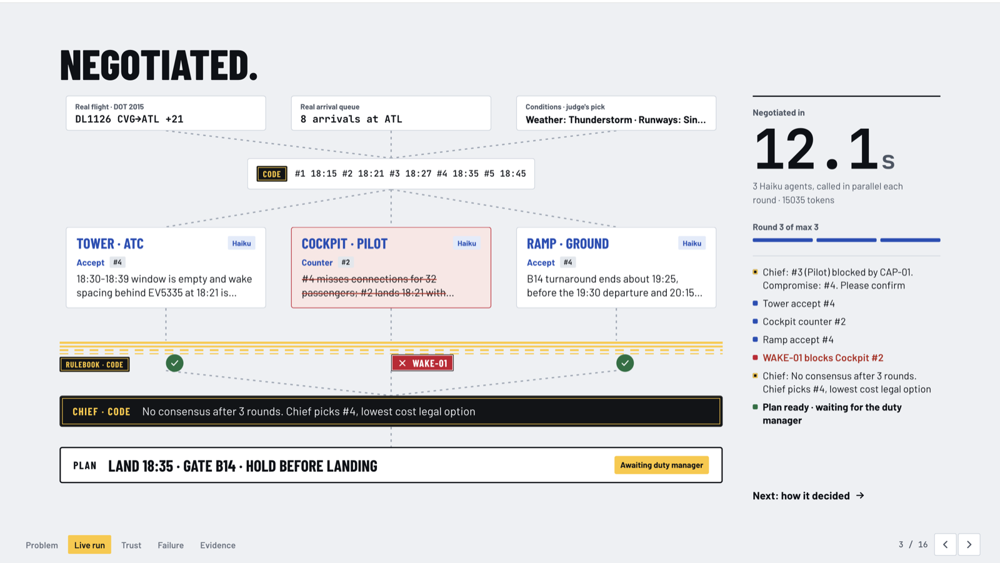
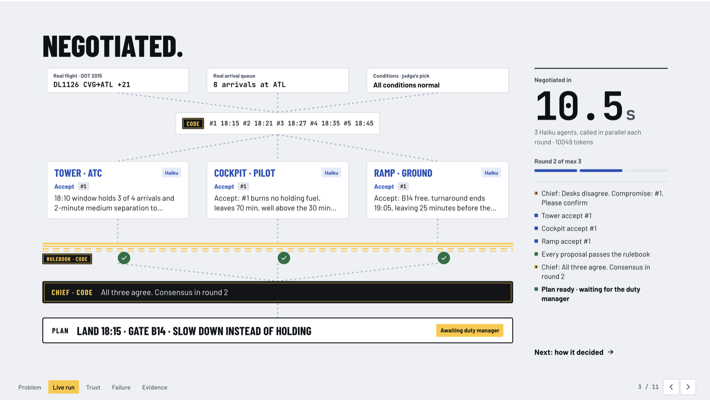
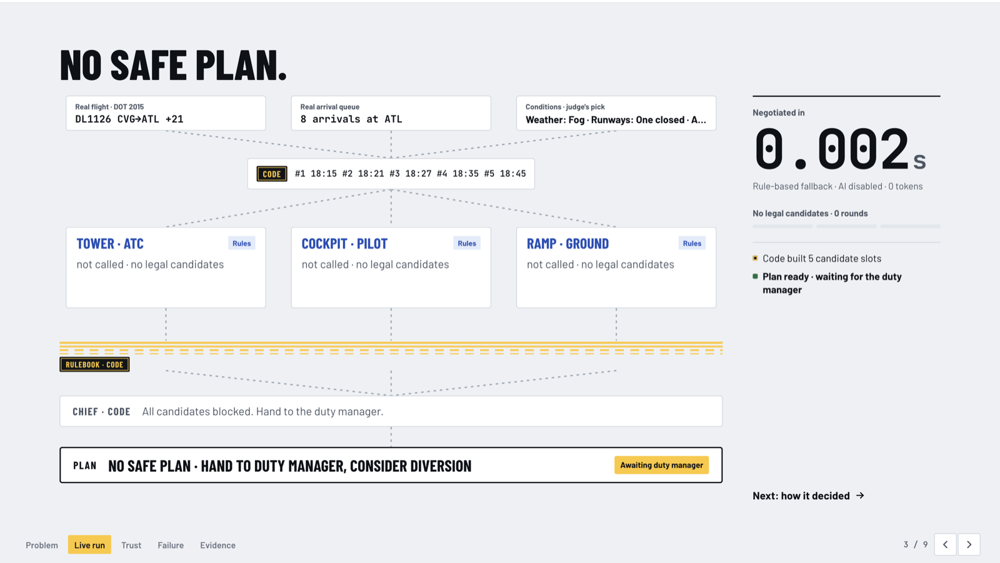

<div align="center">

# ✈️ Concord

**Three AI agents negotiate a flight disruption. A rulebook in code decides what they are allowed to say.**

*The AI can argue, but it can't break the rules.*

[](docs/PLAN.md)
[](requirements.txt)
[](src/api.py)
[](ui/)
[](src/agents.py)
[](LICENSE)

[Demo](#-demo) · [How it works](#-how-it-works) · [The rulebook](#-the-rulebook) · [Results](#-results) · [Quick start](#-quick-start) · [API](#-api) · [Limits](#-honest-limits)



</div>

---

## What is this?

When a thunderstorm closes a runway, today the tower, the cockpit and the ramp fix it over the phone. Each side only sees its own constraints, so the result is holding patterns, burned fuel and missed connections.

Concord puts an AI agent on each desk, **ATC**, **Pilot** and **Ground**, and lets them argue over five candidate plans for one real delayed arrival. Three things keep it honest:

- 🛡️ **A rulebook in plain Python, not an LLM.** Every proposal is checked against four hard aviation rules. A proposal that breaks one is blocked on screen with the rule id and its source, and never adopted.
- ⚖️ **A chief written in code.** It weighs the desks (ATC 3, Pilot 2, Ground 1), builds a compromise from legal options only, and stops after **at most 3 rounds**. No open-ended agent chatter.
- 🧑‍✈️ **A human at the end.** The output is a recommendation plus the full negotiation log and a trace that links every claim to a message or a rule. A duty manager approves or overrides.

The judge picks the conditions (weather, runways, aircraft status, terminal, ramp crew, passengers) and a real flight from the 2015 US DOT delay data. The backend runs the whole negotiation and the UI plays it back step by step.

## 🎬 Demo

One React page is both the pitch deck and the live demo. Walk it with **→**: *Problem → Live run → Trust → Failure → Evidence*.

| All conditions normal | Thunderstorm, single runway | Fog, runway closed, low fuel |
|:---:|:---:|:---:|
|  |  |  |
| Consensus in round 2 | Pilot's counter **blocked by WAKE-01**, no consensus in 3 rounds, chief picks the cheapest legal option | **No safe plan**: the rulebook left no legal candidate, agents are never called |

If the backend is down the UI replays `data/sample_log.json` and shows a **Replay** stamp, so the demo survives a dead venue network.

## ⚙️ How it works

```
one real disruption (row from 2015 US DOT flight delays) + the judge's conditions
        │
        ▼
[code]  world: real flight, delay, cause, arrival queue · simulated gates, fuel, crew, connections
[code]  5 candidate plans: ETA +0 / +6 / +12 / +20 / +30 min, a gate each, slow-down or hold
        │                 (unfiltered: an agent may propose an illegal one, the rulebook blocks it)
        ▼
round 1..3
  ATC · Pilot · Ground   three parallel claude-haiku-5-5 calls, each sees only its own desk's data,
                         fixed JSON via tool use, may only reference candidate numbers
  [code] rulebook        WAKE-01 · CAP-01 · FUEL-01 · GATE-01 on every proposal → BLOCKED + source
  [code] chief           all three accept? consensus. else compromise (ATC 3 · Pilot 2 · Ground 1)
        │
        ▼
consensus                      → plan
no consensus after 3 rounds    → chief picks the cheapest legal option
no legal option at all         → "no safe plan", hand to the duty manager
        │
        ▼
plan + full log + trace (every claim links to a message id or a rule id) · pending human confirmation
```

| Desk | Weight | Hard constraints (veto, enforced by code) | Soft goals (negotiated) |
|---|:---:|---|---|
| 🗼 ATC | 3 | WAKE-01 wake separation · CAP-01 slot capacity | sector throughput |
| 🛩️ Pilot | 2 | FUEL-01 landing fuel reserve | passenger connections, land early |
| 🚜 Ground | 1 | GATE-01 gate conflict | keep the gate, avoid crew overtime, next leg on time |

**Two layers of priority.** Hard rules have no weights: each one is a veto, lives in `src/rules.py` as a pure function and never goes through an LLM. Soft goals are where the agents actually negotiate; the chief breaks ties on soft cost (`delay + 2 × missed connections + 0.5 × crew overtime`).

**Every agent message has the same shape.** Actions are only `rank`, `propose`, `counter`, `accept`, `reject`. No free text between agents, one English sentence of reasoning for the human.

**No key, no problem.** Without `ANTHROPIC_API_KEY` (or on any API error) the agents answer from rules and the log says `ai_enabled: false`. Same screens, same rulebook.

## 📜 The rulebook

| Id | Rule | Source | Simplification |
|---|---|---|---|
| **WAKE-01** | Minimum separation behind the preceding aircraft by wake category | FAA JO 7110.65 §5-5-4 | time gaps (3 min behind Heavy, 2 behind Medium) instead of NM |
| **CAP-01** | Arrivals per 10-minute slot may not exceed the weather-reduced acceptance rate | assumption: real same-day count × weather factor | clear 1.0 · fog 0.6 · thunderstorm 0.5 |
| **FUEL-01** | Fuel on landing must stay above the regulatory reserve | 14 CFR 121.639 | fuel as minutes of endurance; hold burns 1.0/min, slow-down 0.4 |
| **GATE-01** | Two aircraft may not share a gate, 10-minute buffer | logic rule | gate occupancy simulated per scenario |
| CONN-01 | Arriving after the connection cutoff costs one missed connection per passenger | assumption | **soft cost, never a veto** |

The same table drives the UI's Trust screen and `src/rules.py`. It lives in [`data/rules.json`](data/rules.json), with an `assumed` flag on every row.

## 📊 Results

20 real ATL arrivals × 3 condition sets = 60 runs with `claude-haiku-5-5` agents. Full write-up in [`docs/EVAL.md`](docs/EVAL.md); rerun with `scripts/evaluate.py`.

| | Avg delay (min) | Missed connections | Ramp overtime (min) |
|---|:---:|:---:|:---:|
| First come, first served (status quo, no gate coordination) | 81.4 | 760 | 1900 |
| **Concord** (3-desk negotiation) | **48.3** | **224** | **810** |
| Omniscient optimiser (upper bound) | 48.2 | 224 | 804 |

- Consensus within 3 rounds: **47 / 60**. The rest ended with the chief picking the cheapest legal option.
- Injected illegal proposals blocked by the rule layer: **103 / 103**.
- About 10 s and 10k tokens per run.
- **Failure case we show on stage:** WN3917 under fog with a closed runway ended 9 cost points above the optimum, because each desk only sees its own data and the compromise the chief could build from their answers was not the cheapest legal one. Proposed fix: show every desk the soft cost of all legal options in round 2.

The baselines run in our own simulator with the same rulebook, so the numbers are relative comparisons, not operational data.

## 🚀 Quick start

```bash
git clone https://github.com/normanqvq/atc-agent-negotiation.git
cd atc-agent-negotiation

# backend (Python 3.11+)
python3 -m venv .venv && .venv/bin/pip install -r requirements.txt
cp .env.example .env                    # optional: add ANTHROPIC_API_KEY, otherwise agents run on rules
.venv/bin/uvicorn src.api:app --port 8000

# frontend, in a second terminal
cd ui && npm install && npm run dev     # http://localhost:5173, /api is proxied to :8000
```

Open http://localhost:5173, pick conditions and a flight, press **Run**.

Try the pieces from the command line:

```bash
.venv/bin/python -m src.main --pool 1 --weather thunderstorm --runway single --passengers many_connecting
.venv/bin/python -m src.agents        # three agents, one round
.venv/bin/python -m src.rules         # every candidate through the 4 rules
.venv/bin/python scripts/evaluate.py  # 60 runs, rewrites data/sample_eval.json and docs/EVAL.md
```

The step-by-step test script we used on hackathon day is in [`docs/TESTING.md`](docs/TESTING.md).

## 🔌 API

The frontend calls one endpoint (`/api/health` is only a ping). Contract and field list in [`docs/API.md`](docs/API.md).

```http
POST /api/run
{
  "pool_index": 7,
  "environment": {
    "weather": "thunderstorm", "runway": "single", "aircraft_status": "normal",
    "terminal": "tight", "ground_crew": "shift_ending", "passengers": "many_connecting"
  }
}
```

Returns one JSON in the shape of [`data/sample_log.json`](data/sample_log.json): scenario, candidates, every round's messages (with `blocked_by` on blocked ones), rule checks with sources, the decision and its trace, and `meta` (model, seconds, tokens, `ai_enabled`). No streaming: the backend finishes the negotiation, the UI plays it back.

## 🗂️ Repository

```
ui/               React + Vite deck and live console (design notes in ui/DESIGN.md)
src/
  scenario.py     real row from data/pool.json + simulated world from the judge's conditions
  candidates.py   the 5 candidate plans, unfiltered
  rules.py        WAKE-01, CAP-01, FUEL-01, GATE-01 + soft cost. pure Python
  agents.py       three Haiku agents in parallel, strict JSON tool output, rule-based fallback
  chief.py        code, not LLM: consensus check and weighted compromise
  negotiation.py  the 3-round loop, writes the log JSON
  api.py          FastAPI: GET /api/health, POST /api/run
  main.py         CLI for one run
scripts/          build_pool.py (20 real flights from flights.csv), evaluate.py
data/             pool.json, rules.json, sample_log.json (UI contract), sample_eval.json, airlines/airports.csv
docs/             API.md, EVAL.md, TESTING.md, PLAN.md, PROGRESS.md (handoff), screenshots/
```

**Data.** US DOT 2015 flight delays. The flight, its delay, cause and the same-day arrival queue are real. Gates, fuel, crew, connecting passengers and wake category are simulated from the judge's conditions and tagged **SIM** on screen. `flights.csv` is not committed, see [`data/README.md`](data/README.md).

## ⚠️ Honest limits

- One aircraft at a time, no knock-on effects on the rest of the queue.
- Rules are simplified (time gaps instead of nautical miles, scaled counts instead of a real acceptance rate, fuel as minutes). Every simplification is listed next to its rule.
- Our `flights.csv` is a 358,774-row subset, so the arrival queue is about 6% of real traffic density.
- The evaluation uses our own simulator and baselines. It shows the negotiation beats uncoordinated first-come-first-served and matches a full-information optimiser inside that model, nothing more.

## 👥 Team

Built in one day at Autonomous SG 2026 (NUS) for the Airbus AI & Aerospace track.

[Norman Lyu](https://github.com/normanqvq) · [Ma Mingyang](https://github.com/MarcusMa06-code) · [Chris Chen](https://github.com/ChrisChen13) · [Simon Xu](https://github.com/Simon-Xu3)

## 📄 License

[MIT](LICENSE)
